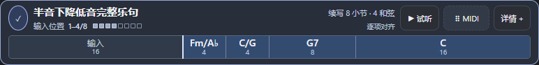
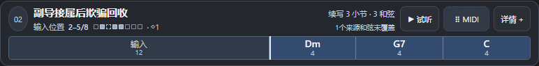
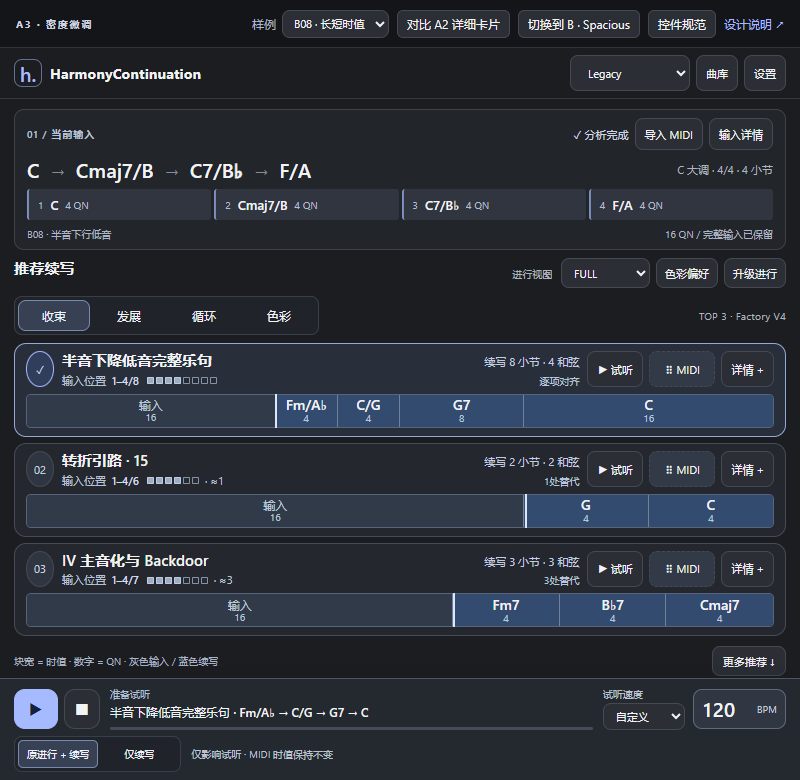
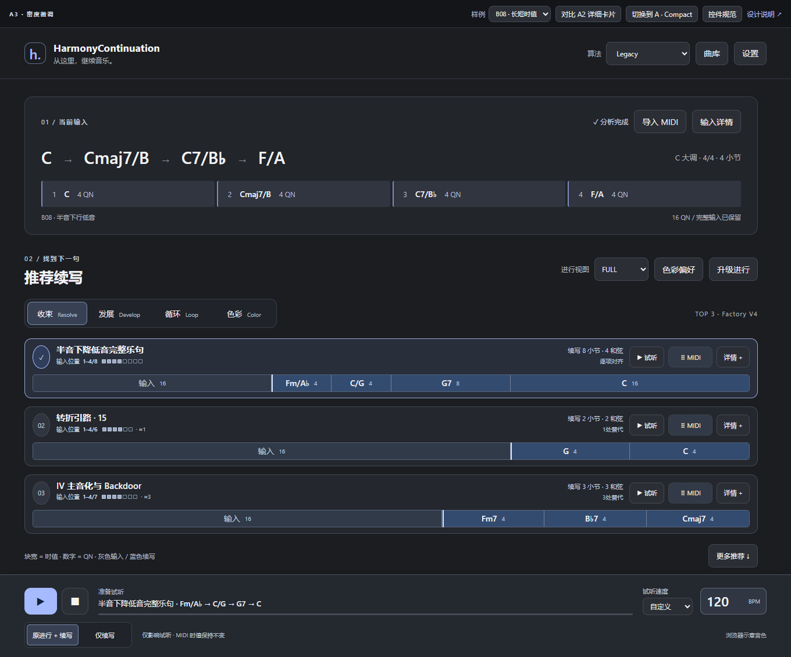

# Phase 7 · UI 审计与设计评审

2026-10-18。**在用户认可的A3恢复版（`bb2deeb`）上小幅提高密度：窗口800×780，卡片增加续写长度/和弦数和匹配差异摘要。名称、输入定位、输入块、续写边界及和弦与时值的直接对应全部保留。生产VSTGUI尚未替换。**

直接用浏览器打开 [交互原型](index.html)。顶部切换 A/B；每卡可选择、展开详情、试听录制 MIDI、保存 MIDI；设置可展开并调整原型缩放。原型无需安装或联网。所有原型文件保持在本目录内。

### A3 精简卡片：两行完成初步判断

A4的呈现方式已撤回；以A3恢复版`bb2deeb`为当前基准。用户于2026-10-18认可该版并要求适当增加信息密度。本轮将区块间距与非音乐标题收紧，默认800×780（含48px评审条），比恢复版降低60px；Top3和底栏仍完整可见。每卡772×93.75，标题及匹配位置旁的空位用于真实摘要，不改现有音乐轨道结构。宽到1400px后仍可两列，见 [宽窗布局](screens/A-wide.png)。

用户认为A2卡片面积和信息过多，因此A3采用信息分层。顶部已显示完整输入，不在每张卡片重复四个输入和弦。

- **进行名称**来自主来源模板的 `nameZh/name`，例如“半音下降低音完整乐句”。收束/排名作为次级信息，Factory ID 仍留在详情。
- **输入位置**简写为“输入位置1–4/8”，旁边用小格显示来源中的匹配区间；`≈`与`◇`保留差异提醒。完整级数、逐项对应和未覆盖和弦进入详情。
- **长度与差异摘要**在现有标题/位置两行右侧显示“续写8小节·4和弦”“逐项对齐”“1处替代”等，便于比较长短与匹配差异。小节数由实际续写QN合计换算，本次两份录制样例均4/4；正式版须读取会话有效拍号，未知拍号只显示QN。匹配摘要只归纳既有alignmentTrace，不推断新音乐理由或质量分数。
- **一条时值带**把已有输入合并为“输入16”灰块，保持其真实总QN宽度；后面只列续写和弦与QN数字。省去每格重复的“QN/小节”、大图例和小节标尺，以页面上一条说明统一解释单位。
- **详情展开**仍提供完整来源定位、逐个输入和弦、QN/小节标尺、Why与音乐信息；卡片播放、MIDI和详情入口独立保留。顶部“对比A2详细卡片”可即时比较两种密度，不是新增产品功能。
- **播放头**沿实际片段推进并描边当前和弦；仅续写试听从输入结束处开始。来源前文和未覆盖和弦不发声、不导出。

顶部“样例”可切换真实 R02 中段匹配记录（Legacy）：F → G → Am。第二张“副导接属后欺骗回收”的来源为 `I IV #ivdim7 V vi ii V7 I`；输入映射到源第2、4、5个和弦，第3个 `#ivdim7` 未被输入覆盖。实际续写仍为 Dm → G7 → C，不会把来源前文或未覆盖和弦插入用户片段。

面积对照见 [A2详细卡片](screens/A2-card-comparison.png)，实测尺寸与A3信息保留检查在`verification.json`的`cardSize`和`a3Information`。窄窗高缩放允许换行或轨道滚动，不通过删除输入块、拆开和弦与时值来塞入更多列。卡片操作36px，固定播放栏40px；实际VSTGUI命中仍待验证。

字段复用：`ProgressionTemplate::{nameZh,name,full}`、`ContinuationCandidate::{primaryTemplate,matchStart,matchEnd,continuationStart,continuation}`、`MatchResult::alignmentTrace` 及输入事件的 `durationQN`。对应入口见 `src/core/ProgressionMatcher.h:55–85,174–190`、`src/core/ContinuationEngine.h:27–50`。现有 `MainView::drawMiniTimeline` 已有拼接时值块与播放头（`MainView.cpp:1086–1112`），正式改造应复用数据语义并改进可读性。

边界规格：OPEN/未知尾长用虚线和“待定”表示；候选建议时值单独标“建议”，不得用默认值冒充确定时长。零时长、无效时间或未知坐标不画伪造等宽时值块。短和弦过密时横向滚动，最小格宽只扩大整条时间轨道，不逐格拉宽而破坏比例。循环接续要明确标记回到来源开头；多来源合并卡片只突出主来源，在详情列出其余来源。这些边界尚未在本轮录制样例中全部覆盖，须在正式 VSTGUI 阶段验证。

## 1. 基线与证据范围

- 源码基线：GitHub `OldLai-ctrl/HarmonyContinuation`，`development/phase5-20261013`，`66d7f0713b31f0e5180abf97d14d5a2b9dfc51ac`。本轮通过本机有效代理执行 `ls-remote` 核实，随后建立 `design/phase7-ui-20261016` 隔离工作树。
- 插件既有构建：`0.10.0-dev.7` / BuildCommit `8c27c27a0c50da7fb0cf991f60ecde66890116f0`。版本源配置是 `CMakeLists.txt:2–7`；包身份与旧工程结果见 [Phase 6 报告](../../docs/PHASE6_ENGINEERING_20261014.md)。本轮没有重新构建、安装或核验正在加载的插件。
- Factory V4 / 657 条为既有基线记录。本轮没有改变 Factory、核心推荐算法、User Library 或任何 Schema，也没有运行会访问真实用户库的 Demo。
- 原 `HarmonyContinuation-release` 工作区已有未提交文档改动，保留原样。隔离设计工作树从 GitHub 已提交基线建立，未把那些改动混入此次提交。当前用户提供的工作规则仍适用于本轮。
- 两位 Luna 子代理只读整理 UI 功能调用链、Preview/MIDI/宿主可行性；主代理决定信息架构、实现原型、核对关键源码与图片、负责最终门禁。未将子代理摘要等同于运行验证。

### 真实原型样例

输入采用既有 Phase 6 `run-final-verified/top3.tsv` 的 `B08_4-4_fixed-4qn`：C → Cmaj7/B → C7/B♭ → F/A，C Major，4/4，120 BPM，输入每和弦 4 QN。该 TSV 的 SHA-256：`d5606a019db010a99f333fca1b9e924c2cbc2722a4100b8bb899a9cc80b87fea`。包含 B08 三种算法各三条 Resolve 候选，以及 `R02_CMAJOR_4-4_fixed-4qn` 的 Legacy Resolve Top3。名称和来源级数取自 `data/factory-v4/candidates.json`、`data/factory-v3/spark.json`、`data/factory/pop.json`；匹配窗口和对应关系取同批 `matches.tsv`。摘录在 [data.js](data.js)，24 份完整/后缀 MIDI 在 [midi/](midi/)。谱名中的 `Ab/Bb` 仅在视图中排为 `A♭/B♭`。

| 排名 | 实际候选 | 完整续写路线 | 原始 QN 时值 | 排名分 |
| --- | --- | --- | --- | --- |
| 1 | V4_B08 | Fm/A♭ → C/G → G7 → C | 4 / 4 / 8 / 16 | 81.6983 |
| 2 | V3_SPARK_015 | G → C | 4 / 4 | 65.8727 |
| 3 | V4_B07 | Fm7 → B♭7 → Cmaj7 | 4 / 4 / 4 | 63.6076 |

分数、来源 ID、支持来源和路线均来自录制结果；未重新推断推荐。此 B08 样例不证明三个算法整体等价，也不代表用户听评通过。第一条 Why 的 SameDegree / SameFunction / SameRole / SecondaryTargetMatch 来自同批 `matches.tsv` 的 V4_B08 行。

## 2. 现有 UI 审计与功能迁移表

频率是依据本次创作工作流的设计估计，无使用遥测。表内行号对应源码基线 `66d7f07`。新入口属于待批准的正式实施规格；原型中未接业务的次级入口会显示说明。

| 功能 | 现入口 → 操作步骤 | 频率 | 新入口 | 展开 | 依赖 / 源码证据 |
| --- | --- | --- | --- | --- | --- |
| MIDI 文件输入 | More → Import MIDI → 选择完整/开放尾部；或拖入时间轴 | 高 | 顶部“导入 MIDI”与输入区拖入 | 导入选项 | MainView.cpp:418–435,1613–1655；Controller.cpp:696–735 |
| 宿主和弦输入、刷新、剪贴板 | 宿主拖入；顶部/More 中刷新与剪贴板 | 高/中 | 输入区来源与状态；输入详情保留刷新、剪贴板 | 次级动作 | Controller.cpp:574–617；保持宿主适配能力边界，不承诺自动捕获 |
| 已有进行、时间轴、当前和弦 | 主屏时间轴 → 和弦检查器；滚轮横向滚动 | 高 | 顶部完整进行与简明时间轴 | 和弦详情 | MainView.cpp:963–1018,1068–1084；CurrentChordLocator |
| 调性、候选调性、手动覆盖 | 顶部调性控件 → 选择 | 高/中 | 输入上下文条；“输入详情”选择/恢复自动 | 次级编辑 | MainView.cpp:1019–1042,1527–1612；PluginSessionState |
| 拍号、输入时值与未知尾长 | MIDI/Session 提供；宿主信息另行显示 | 高（读） | 调性旁显示值与来源，未知时明确标示 | 原始信息 | Controller.cpp:588–596,710–716；不把宿主拍号反推原始时值 |
| FULL / SKELETON | 时间轴下切换展示 | 中高 | 显式“进行视图”选择 | 否 | MainView.cpp:1068–1084,1536–1538；**只是视图，不能误实现为新的匹配算法** |
| 风格、倾向、旋律约束 | 顶部控件/约束编辑表单 | 中 | 输入详情中的约束区；当前启用项给摘要 | 是 | PluginSessionState.h:14–35；MainView.cpp:1527–1612,1714–1784 |
| Resolve / Develop / Loop / Color | 四组并列或滚动；意图把偏好组排前 | 高 | 单页四段意图控件，同区域切换组 | 否 | MainView.cpp:87–94,1115–1177；沿用现有 intent 请求语义 |
| Factory 推荐 / Top3 | 每组默认最多三项，短区域只能容纳两行 | 高 | 当前意图的 Top3 完整路线卡 | 否 | ProductServices.cpp:109–122；保留默认可见性策略 |
| 更多推荐 | 每组 More → 原生弹出列表 | 中高 | 当前列表下方“更多推荐”展开可滚动卡片 | 一次 | MainView.cpp:1888–1935；retained 与 defaultPresented 分开，不丢候选 |
| 试听、停止、进度 | 卡片 ▶；同候选再次点击停止 | 高 | 卡片独立试听；固定底栏显示对象与停止 | 否 | Controller.cpp:416–503；播放来自 Windows 默认音频设备 |
| 保存 MIDI 与标准拖放 | 卡片 MIDI：点击保存，移动开始拖动 | 高 | 独立虚线 MIDI 手柄；详情中保存文件 | 保存一次 | MainView.cpp:1488–1518；MidiDragService；kFilePath |
| 当前输入 MIDI | More → 当前进行 MIDI | 中 | 输入详情 → 导出当前进行 | 一次 | MainView.cpp:1613–1655；Controller 当前输入导出路径 |
| Why V2、匹配/音乐信息 | 卡片 Why → 检查器，窄屏覆盖内容 | 中 | 卡片内部详情；低频完整指标继续折叠 | 一次/二次 | MainView.cpp:2033–2165；WhyExplanation；不在 UI 重写解释算法 |
| Enrichment / 和弦升级 | 顶部 Enrich → Polish/Rich/Advanced | 中高 | 主创作区“升级进行”，同页显示三个层级 | 一次 | MainView.cpp:1179–1253；升级对象明确为当前输入；沿用候选回调 |
| 色彩偏好、提示开关 | 顶部/下方弹出菜单；卡片提示 | 中 | 推荐区“色彩偏好”，启用后显示当前值 | 一次 | MainView.cpp:1038–1042；ColorPreferenceReranker；仅原有展示排序 |
| 曲库与搜索过滤 | More → Library → 搜索/过滤/条目 | 中低 | 顶部“曲库”抽屉；关闭回原位置 | 一次 | MainView.cpp:1789–1842,1937–1982；Factory/User 分源 |
| 收藏、保存到用户库 | 卡片保存表单或用户项收藏 | 中 | 卡片详情收藏/保存表单；曲库收藏过滤 | 一次 | SaveMetadata；Controller::save；保留显式用户写入 |
| 用户项改名、元数据、删除 | 用户条目 → 检查器操作 | 低 | 曲库条目详情 | 是 | MainView.cpp:1468–1484,2255–2260；原有验证与确认仍保留 |
| 批量 MIDI 导入到曲库 | 现有 importMidiFiles 回调及导入流程 | 低 | 曲库导入菜单 | 是 | MainView.h:61–62；不改用户数据库契约 |
| 快照保存/打开 | 卡片 SNAP；More → Open Snapshot | 中低 | 卡片详情“保存快照”；输入详情“打开快照” | 一次 | Controller.cpp:642–679；冻结模式与快照标识须保留 |
| 固定比较、移除 | 卡片 Pin → 最多三项比较栏 | 中 | 卡片详情固定；底栏上方可折叠比较带 | 一次 | MainView.cpp:1277–1346,1924–1925；继续发展与升级的 pin 存储各自保留 |
| 三算法预设 | 主屏第三行开发模式按钮 | 当前高 | 顶部一级下拉，持续显示当前模式 | 一级 | Controller.cpp:318–349；重开默认 Legacy 的现行为保持 |
| 诊断、导出、About | More → Diagnostics/About；Match 标签也跳诊断 | 低 | 设置 → 诊断/About；输入失败时给就近入口 | 一次 | MainView.cpp:1613–1641,1663–1667,1984–2032 |
| 中英、用户缩放、宿主 DPI | More 中 locale/100/125/150%；宿主另给 contentScale | 低 | 设置中语言与缩放；宿主适配独立 | 一次 | MainView.cpp:1613–1622；PluginView.cpp:225–246；EffectiveScale |

### 审计发现

1. 原界面通过绘制文本与手工矩形判断处理多类操作，可点击区域的边界表现不统一。新版绘制与命中须共用同一矩形，避免多套坐标。
2. 导入文件藏在 More；四意图、多页入口和检查器增加导航与滚动。新版保留一个日常创作页，低频编辑仍按需展开。
3. More 当前是菜单，不具备卡片上直接试听/拖出的操作组。改为同区追加卡片后，主流程可以连续完成。
4. 同一 MIDI 控件同时承担点击保存和拖放；新设计分开手柄与保存按钮，同时保留标准系统拖放与文件回退。
5. Preview 没有独立 BPM 设置、暂停游标或固定控制栏。不能仅添加图标就宣称能力可用。
6. 现有算法切换已停止试听并清空结果；必须复用这条路径。其他请求重算仍需核对 ready/generation 对显示和动作的门禁。

## 3. 新主创作流程与十项需求回应

**导入 MIDI / 宿主输入 → 确认完整进行、调性与拍号 → 选择意图 → 直接试听 Top3 → 改速并重播 → 拖出 MIDI。** 以上均留在创作页。切换卡片立即更新底栏对象；单纯选择不自动播放。继续发展与升级进行共用对象明确的播放器。

| 用户痛点 | 本轮设计回应 |
| --- | --- |
| 可点击文字缺少边框 | 所有按钮有形状、填充或明确分段控件边界；普通说明保持非交互 |
| 视觉与命中不一致 | 共享布局几何；选择、播放、手柄、详情各有独立矩形 |
| 页面切换多 | 创作单页；输入、推荐、播放同屏；曲库/诊断按需进入 |
| 试听不便 | 每卡一键试听，底栏固定；对象、播放状态、范围持续可见 |
| MIDI 拖放不便 | 每卡独立 ⠿ MIDI 手柄，保存回退在详情 |
| 不能调整试听速度 | 独立 BPM 数值和“跟随宿主/自定义”；详见技术边界 |
| 布局层级不满意 | 输入—推荐—播放分区；和弦路线优先于 ID、分数 |
| 尽可能极简 | 同一意图优先 Top3；主色仅一种；去掉主屏内部指标 |
| 复杂低频功能展开 | Why、约束、曲库管理、诊断按需；测试阶段算法保持一级可达 |
| 自然舒适、Apple 理念 | 明确层级、留白、一致按钮、可见反馈、克制动效；不复制专有素材 |

## 4. 两套高保真原型

### A · Apple Compact

用户已选择该布局。当前密度微调截图为800×780（含48px评审条），Top3同时可见。每卡保留原有音乐轨道，并在同一标题/位置行补充续写长度与对齐差异；完整结构可展开，底栏固定。

### B · Apple Spacious

保留为对照，数据与A3精简卡片同步。主视图截图为1360×1130（含评审条），外层布局留白更多。用户已选A，B不再是待选择项。

| 项目 | A | B |
| --- | --- | --- |
| 核心能力 | 共享同一 JS、数据与行为 | 同 A |
| 信息密度 | 中高，比较路径短 | 中等，音乐内容突出 |
| 输入与卡片占用 | 较小 | 较大 |
| 字号 / 点击舒适度 | 紧凑，主操作 44px | 路线更大，主操作 48px |
| 小窗口高缩放 | 需滚动，底栏固定 | 更早进入滚动，优先收紧留白 |
| 推荐使用方式 | 日常 DAW 默认 | 大窗口专注探索 |

**已确认采用A；A3回应本轮“小而精”的要求。** 正式实施保留核心判断信息，并按需展开完整结构，不恢复A2的双轨常驻布局。

### 状态图入口

| 状态 | A | B |
| --- | --- | --- |
| 展开详情 | [A-detail](screens/A-detail.png) | [B-detail](screens/B-detail.png) |
| 正在试听 | [A-playing](screens/A-playing.png) | [B-playing](screens/B-playing.png) |
| MIDI 手柄与演示接收区 | [A-drag](screens/A-drag.png) | [B-drag](screens/B-drag.png) |
| 高级设置 | [A-settings](screens/A-settings.png) | [B-settings](screens/B-settings.png) |
| 加载 / 旧结果清空 | [A-loading](screens/A-loading.png) | [B-loading](screens/B-loading.png) |
| 900×640 / 150% | [A-small-150](screens/A-small-150.png) | [B-small-150](screens/B-small-150.png) |
| 共享控件状态 | [默认、悬停、选中、按下、禁用、加载、焦点](screens/controls.png) | 同一规范 |

## 5. 视觉与交互规范

### 视觉 token 与资源

背景 `#1b1d21`，面板 `#24272d`，控件 `#2b2e35`，边界 `#444952`，文字 `#f2f3f5`，次级字 `#afb5bf`，单一强调色 `#a6baff`。卡片圆角 12px、输入面板 14px、按钮 8px；控件间距至少 8px。选中同时使用边框、✓ 与“已选中”，不只靠颜色。正式产品主操作 ≥44px；A 次级控件 ≥36px，B ≥40px。原型顶部评审工具条不属于插件产品控件。

建议 Windows 使用已安装的 `Segoe UI` / `Microsoft YaHei UI`，系统字体引用不打包字体文件；缺少字体时走经目标系统验证的 fallback。未依赖 macOS 独占字体、SF Symbols 或 Apple 商标图形。原型标记由文本/简单 CSS 绘制。正式 VSTGUI 需验证字体度量、中文截断、降号、井号、斜杠和数字基线。

参考 [Apple HIG — Buttons](https://developer.apple.com/design/human-interface-guidelines/buttons) 的清楚含义、可识别形状、适当间距和按下反馈原则；该规范的一般触达建议为 44pt。本项目针对 Windows DAW 鼠标操作设计 36–48 逻辑像素控件，需要实机确认，未声称等同于 Apple 平台控件或完整遵循其平台规范。布局参考入口：[Apple HIG — Layout](https://developer.apple.com/design/human-interface-guidelines/layout)。本轮已读取 Buttons 官方正文；Layout 页面仅确认官方入口，未将未获取正文当作证据。

### 操作状态与命中

- 默认：中灰边界与背景区别；悬停：边框和背景提亮；按下：背景收暗；选中：✓、文本与描边；焦点：2px 外框；禁用：降低对比但保留标签和原因；加载：文字状态与不可操作卡区。
- 共用布局矩形绘制/命中，逻辑坐标只做一次用户缩放变换，宿主 contentScale 单独处理。不得扩大透明命中区盖住邻近按钮。
- 卡片显式圆形选择按钮；卡片普通文字不承担隐藏点击。播放、MIDI、详情不会冒泡为选择动作。详情就地展开，播放栏不跟随内容滚走。
- MIDI 按下 6px 后启动拖动（正式实现优先沿用系统/现有阈值并检查 DPI）。拖放取消有状态反馈；手柄单击解释拖动，文件保存使用独立按钮。正式版保留 `MidiDragService` + VSTGUI `kFilePath` + Windows `CF_HDROP`，不增加私有协议。
- 试听范围与 MIDI 导出范围独立。导出默认完整进行，详情可显式选择仅续写；仅切换试听范围不会暗改导出文件。BPM 从不写回输入进行或宿主工程。
- 长路线换行完整显示；超长输入时间轴允许横向滚动。空输入、分析中、失败、空推荐、快照冻结、用户库不可用须有明确文案和重试/恢复入口，不能显示假 Top3。
- 切算法时停止试听、清选择/展开/待拖 payload、清旧卡并显示计算中；只应用当前 generation + preset 的结果。新结果原子更新后解禁。失败时保持可诊断空态，不恢复旧结果。
- 原型没有生产 worker；其 600ms 状态演示是“读取录制样例”，不是伪造算法计算时长。连续切换通过局部 generation 忽略旧演示请求。
- 默认无入场动画、模糊和循环装饰动效；正式版仅可在低成本局部区域使用短暂状态过渡，并尊重减少动态效果设置。

## 6. Preview BPM 与架构可行性

READY 表示现有源码有可复用能力；SMALL CHANGE 表示接线或局部改动；HIGH RISK 表示需要额外设计和验证。均不代表真实 Cubase 已验收。

| 项目 | 分类 | 现状与最小方案 |
| --- | --- | --- |
| 固定底栏 | SMALL CHANGE | `UILayout.h:30,93–98` 无专属底栏；增加 footer rect，从主内容、检查器和 pin 比较带扣除其高度 |
| 自定义 BPM | SMALL CHANGE | `PreviewSequence.cpp:14–35` 已有 BPM/QN 转换；Controller 当前传 `lastTempoBPM_`。新增实例级 auditionTempo，禁止写回同名导出/宿主字段 |
| 宿主有效性 | READY + 显示小改 | `HostContextAdapter.cpp:35–46` 检查 `kTempoValid`、有限值与 20–400 范围。Controller.cpp:795–806 只缓存有效值；无历史值默认 120，之后保留 last-good |
| 播放时改速 | SMALL CHANGE（停止后重播）；HIGH RISK（连续变速） | `Controller.cpp:430–470` 离线 WAV + PlaySound，`OfflinePreviewRenderer.cpp:8–22` 固定速率渲染。先停止并从头重播；连续变速需新的播放后端 |
| 停止 / 暂停 | READY（停止）；HIGH RISK（可恢复暂停） | `Controller.cpp:416–428,474–503` 有停止/清进度，无恢复游标。原型只设计播放/停止 |
| 仅试听续写 | SMALL CHANGE，需定向验证 | `PreviewSequence.cpp:78–85` 标出 recommendationBoundary 与 Recommended 事件，但 audition 当前只播放全段。推荐完整生成/声部配置后按边界裁切、归零，避免直接从后缀重做声部导致音色/voicing比较失真 |
| 仅续写 MIDI | READY 核心 / SMALL CHANGE 接线 | `MidiClip.cpp:54–98` 已支持 ContinuationOnly；`MidiWorkflow.h:5–11` 默认 FullPhrase；显式把独立导出 scope 传入 |
| 卡片标准拖放 | READY 源码 / 宿主待验 | `MainView.cpp:1488–1518` 生成 .mid 后 kFilePath；新手柄只改命中/提示与入口。已读本机 SDK `vstgui4/vstgui/lib/platform/win32/win32dragging.cpp:614–619` 的 CF_HDROP 映射（DEBUG 注释仍写 not yet tested）；真实 Cubase 接收仍待验 |
| 展开/进度重绘 | SMALL CHANGE | `MainView.cpp:572–574` 试听进度目前整 view invalid；`963–970` 宿主位置已有局部失效可复用。缓存 Why 文本与布局，不在 draw 时重算音乐 |
| 窗口与 DPI | READY 现有机制 / SMALL CHANGE 布局 | `UILayout.h:66–70` 用户缩放、`PluginView.cpp:225–246` 宿主缩放均已有。新增底栏后复用布局测试并实测跨屏 |
| 实例 UI 状态 | READY + 局部字段 | 状态归 Controller/MainView 实例；新增试听设置不放全局，先不写 Session Schema |
| 多实例同时试听 | HIGH RISK | `HostEnvironment.h:41–50` / `.cpp:61–65` PlaySound 进程级所有权。现有模式为第二实例抢占第一实例；必须同步显示停止，不承诺并行发声 |
| Windows 中文字体 | SMALL CHANGE + 目标机验证 | `MainView.cpp:34–36` 用 kNormalFont；本机 SDK `vstgui4/vstgui/lib/cfont.cpp:62–70` 的 Windows 默认是 Arial。需显式字体回退和度量检查。浏览器中文截图不能证明 VSTGUI 中文效果 |
| UI/Controller 边界 | READY | `MainView.h:42–66` Actions + `PluginView.cpp:100–134` 接线；UI 传用户意图与展示状态，不放和声算法、DB 或音频合成 |
| 异步结果门禁 | READY + UI统一 | `RecommendationWorker.cpp:132–153,271–274` 与 `Controller.cpp:272–305` generation/preset 双重检查；`setAlgorithmPreset` 已清空旧结果。保留这一正确行为，新增底栏和手柄也必须受 ready 状态约束 |

### BPM 最小技术设计（待正式实施）

Controller 拥有 `tempoMode { FollowHost, Custom }`、`customBpm`、`hostTempoValid`、`lastValidHostBpm`、`previewBpmAtStart`、`previewScope`，全部按实例保留。初始范围沿用 Preview 的 **20–400 BPM**。不改 Session Schema；跨工程持久化暂不增加。

有效试听速度：Custom → customBpm；FollowHost 且有效 → 当前宿主值；否则 → 最后有效宿主值或初始 120。界面分别显示“跟随宿主 120”“宿主速度不可用，沿用最后有效 120”或“宿主速度不可用，回退 120”。自定义速度在切换到 FollowHost 后保留，切回恢复。

一次播放开始时冻结所用 BPM，并显示该值。用户改速度/切范围/切模式时停止并给“从头播放”入口。宿主在播放中变速时，标示“宿主已变速，下次播放使用 X”，当前 WAV 按原速度结束；不持续停止重渲染或假装实时同步。后续若要求无缝变速，另行选择播放后端。

试听调用链：MainView Actions → PluginView → Controller 验证 ready/输入 → PreviewSequence（QN 不变，独立 tempo）→ OfflinePreviewRenderer → 现有系统播放器。离线渲染目前同步进行，长序列/低 BPM 可增加等待；正式实施应给真实“生成试听中”状态、复用资源上限，必要时把已有离线渲染移出 UI 线程并带取消代次，不提前重写合成器。

仅续写试听优先复用全段生成后的输出与 recommendationBoundary，保留完整上下文 voice-leading 后裁切；片段转换后局部零点与 UI 播放头须一致。现有 `MidiClip::ContinuationOnly` 证明后缀边界能力，不等于当前 Preview 已提供 suffix-only 按钮。边界涉及旋律约束拆分、OPEN 尾长与空后缀，需在正式阶段用现有 fixture 验证。

MIDI 继续走独立 `CandidateExportContext`：保持原始事件 QN、宿主/既有导出 tempo marker 和默认 FullPhrase。调试听 BPM 前后应逐字节比较同候选同导出 scope 的 SMF；显示层也不能把秒换算回写进输入。用户明确改导出 scope 才切换至 ContinuationOnly。

## 7. 正式 VSTGUI 工作包（布局批准后）

| 顺序 | 文件与职责 | 验收 / 停止条件 |
| --- | --- | --- |
| P7-1 几何与交互状态 | `src/ui/UILayout.h`、`MainView.h/.cpp`：单页分区、独立命中矩形、底栏、详情/曲库折叠、Top3/More、固定比较 | 两方案选定后只实现批准布局；复用 UILayoutTests 和 UI smoke，核对最小窗口与三档缩放 |
| P7-2 业务入口迁移 | `MainView`、`PluginView.cpp`、`Localization.*`：迁移表逐项接线，复用 Why/Enrichment/色彩与曲库逻辑 | 每个旧入口可从新入口到达；中英文不截断；FULL/SKELETON 只改展示；不碰音乐算法 |
| P7-3 Preview 控制 | `Controller.h/.cpp`、`MainView::Actions`、`PluginView.cpp`；必要时 `PreviewSequence.*` / `OfflinePreviewRenderer.*` 增加后缀裁切辅助 | 独立20–400 BPM；不可用宿主回退；停止重播；OPEN/约束边界；试听对象与进度一致；不重写 PreviewSynth |
| P7-4 MIDI 与过期动作 | `MainView` 手柄、`Controller` payload 参数；复用 `MidiWorkflow` / `MidiClip` / `MidiDragService` | 保存/拖动分离；标准 CF_HDROP；scope 显式；改速前后 SMF/QN 不变；切算法期间旧候选不可操作 |
| P7-5 性能与宿主验收 | `MainView` 局部 invalid；必要的既有测试；更新实际验收记录 | 20Hz附近进度轮询不整屏重绘；实例抢占反馈；100/125/150%、跨屏中文字体、真实 Cubase 拖放与重开验收 |

不需要修改 `core` 推荐引擎、Factory 源数据、数据库、Session Schema。`PreviewSynth` 当前无需重写；只有明确的后缀上下文或资源问题才局部调整。自动化优先复用现有 `UILayoutTests`、Preview/MIDI 测试和 Demo 定向 smoke；仅对独立 BPM、后缀试听边界、手柄命中等具体覆盖缺口补最小用例。批准后也不能把浏览器布局通过当作 VSTGUI/宿主通过。

## 8. 原型验证与实现边界

实际执行记录：[verification.json](verification.json)。使用现有 Node/Playwright 和系统 Edge 离屏渲染，唯一新增 `render.cjs` 同时生成用户要求的 PNG 并检查原型。未引入新安装工具链，未构建 VST3。

- 21张PNG：两方案主要状态、卡片/中段样例、仅续写播放、小窗口、A2对照和宽窗两列。`a3Information`继续核对原有音乐信息；新增`cardFacts`核对三张卡的实际小节数/和弦数，以及逐项对齐/替代次数；R02另验未覆盖提示。
- A/B × 640×720 / 720×800 / 800×780 / 900×640 / 1440×1100 × 100/125/150%，30组合通过。默认800×780另验Top3完整可见，1440宽验两列仍保留输入块和边界。浏览器缩放不代替Windows DPI/VSTGUI验证。
- 验证4:8:16 QN的块宽比为1:2:4、真实来源名称、R02中段匹配的来源前文/3个对应输入/1个未覆盖和弦，以及仅续写播放头从输入边界出发。还覆盖详情、选择、90 BPM试听调度、停止复位、原始 MIDI 字节不变、宿主缺失回退、算法加载门禁、视图切换、MIDI下载和内部拖动。离屏检查验证调度状态，不作为人工听评。
- 原型音频按录制 MIDI 的音高、时值与力度经 WebAudio 三角波发声，标注“浏览器示意音色”；不是 PreviewSynth，也不是音乐质量验收。它可用于理解播放/停止/速度交互。
- 原型的拖放只到显式内部演示接收区；真实系统/DAW Drag-Out 未接线。可以从详情保存真实录制 MIDI。原型的保存不依赖宿主。
- Develop/Loop/Color、骨架索引、Enrichment、更多候选在此 B08 快照中未记录，显示明确空态或功能说明；不伪造数据。收藏/固定/诊断/快照/完整语言切换等次级入口是带说明的设计入口，不会写入真实库或声称动作完成。正式行为保留在迁移表与工作包中。

### 布局风险与建议

小窗口或高缩放允许内容滚动；完整音乐信息的优先级高于同时显示更多列。现有生产`UILayoutResult`最低宽度仍900px，800px仅为本轮原型目标，正式实施须调整窗口约束并验证字体、DPI与命中。宽窗两列需确保原有时值带可读，不强制三列。

复现：在本目录使用已安装 Playwright 的 Node 环境执行 `node render.cjs`；可用 `HC_BROWSER` 指向本机 Edge/Chrome，`NODE_PATH` 指向现有模块目录。该脚本仅打开本地原型，不加载插件、数据库或浏览器个人资料。

## 9. 交付清单与最终门禁

| 文件 | 用途 |
| --- | --- |
| `index.html`、`prototype.css`、`prototype.js` | A/B 共享交互原型与视觉规范 |
| `data.js`、`midi/*.mid` | 可追溯真实 B08 推荐与完整/后缀 MIDI |
| `screens/*.png` | 15 张高保真状态与布局图片 |
| `render.cjs`、`verification.json` | 必要截图生成及本轮原型验证记录 |
| 本 README | 审计、迁移、架构、设计规范、可行性与工作包的唯一详细说明 |
| 根 `NOW.md` / `MAP.md` / `PROJECT_INDEX.md` | 接续状态、隔离分支及入口链接 |

Git 提交与推送结果以当前分支及远端读回为准；不合并 main、不新建正式发布，不更新安装包。

| 门禁 | 结果 |
| --- | --- |
| UI AUDIT COMPLETE | YES |
| FEATURE MIGRATION MAPPED | YES |
| APPLE COMPACT PROTOTYPE | YES |
| APPLE SPACIOUS PROTOTYPE | YES |
| PREVIEW BPM FEASIBILITY | CONFIRMED（源码方案；生产实现/宿主运行待验证） |
| MIDI DRAG UX SPECIFIED | YES |
| CORE MUSIC ALGORITHM CHANGED | NO |
| FACTORY V4 CHANGED | NO |
| PRODUCTION UI REPLACED | NO |
| READY FOR USER DESIGN REVIEW | YES |
| READY FOR REAL CUBASE ACCEPTANCE | NO |

用户已认可 **A3恢复版**；本轮在该版上增加少量判断摘要并降低窗口高度，保留全部重要音乐信息。生产VSTGUI尚未实施。无缝变速、真正暂停、多实例并行音频与真实宿主接收仍需各自证据。
