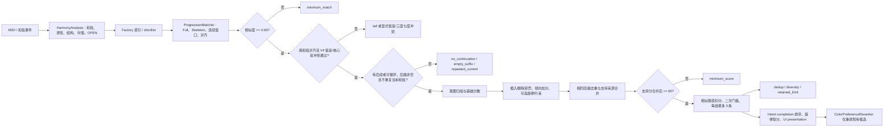

# HarmonyContinuation Phase 3-SYS-AUDIT

日期：2026-10-11
审计对象：HarmonyContinuation Library V4 推荐引擎，Factory V4 657 条
范围：隔离测试、静态代码核对、离线反事实；没有修改正式推荐逻辑。

## 结论摘要

本轮对 657 条 Factory 的受限输入空间做了逐条追踪。测试覆盖了每条进行的全部前缀终点、已声明骨架、受限中间片段、转到 G 的相对进行，以及 38 个自编/回归样本的 MIDI 变形。覆盖不是“所有可能用户输入”；明细里的零曝光只表示在本轮已测样本中没有作为主候选展示。

已确认的关键现象：

1. 检索索引没有提前裁掉 Factory 条目：657 条小于 800 条 shortlist 上限，每次测试均把全部 Factory 交给匹配器。之后仍有大量匹配记录在相似度、续写、分数、去重、多样性或每组前三位被挡下。
2. R01 在 4QN 模拟输入中存在合理的 Factory 续写路径，但 5 条能续写的候选均未过 60 分门槛。V4_A08 的 57.4039 分由分项公式和一次 -8 分未解释插入惩罚复算得到。
3. R01 将每个和弦的时值从 4QN 改为 2QN 后，V4_A08 的候选分数越过门槛。对齐记录显示 G#dim 插入由 `StructuralInsertion` 变为 `EmbellishingInsertion|LowStructuralPenalty`，匹配相似度由 0.674117 升至 0.769499。变化来自时值与小节位置影响和声结构权重及插入代价，不是独立的节奏子分变化；这证明节奏信息会通过和声结构分析影响召回。
4. R02 的固定模拟仍无 Color 输出。C 大调 84 条 Color 匹配都没过 0.60 相似度门槛；A 小调 4 条 Color 匹配中，3 条低于该门槛，COMMON_MINOR_015 虽相似度 0.961633，但路径已结束且不可循环。它们在评分和 UI 排序前已经消失。真实 Cubase 差异仍未定位。
5. 11 条 Factory 在本轮样本中没有作为主候选展示。10 条曾作为合并来源出现；ROCK_011 有 76.9546 分的路径，但被每组前三位上限拦下。没有证据说明这些条目在所有用户输入中不可达。
6. 稳定性矩阵里，220 个 MIDI 变形有 212 个被识别；8 个省略五度变形未得到可识别的进行。在 176 组基线和变形均有候选的比较里，164 组候选集合重合度至少 0.8，155 组集合完全相同。候选分数仍可能变化。

这里的“评分偏差已测量”表示分布和敏感性已量化；没有人工听觉标注，不能据此断言某个候选音乐质量好或坏，也没有证明现有权重在所有语境中不公平。

## 1. 基线、范围与复现方式

| 项目 | 核实结果 |
|---|---|
| 分支 / HEAD | `library/v4` / `42a915bda447457bd1bdc8b2f79a90e5ddc69c00` |
| 构建 | Windows x64，CMake + Ninja，Release，MSVC 14.43 |
| Factory | 657 条；`build-v4-dev2/factory.db` SHA-256：`74C529828F8C4B934BBAF4ADA719AA95491AB498B58885522124FF6505671534` |
| Phase 3A 评分例外 | `RecommendationWeights{}.diminishedPassingInsertionException == false`；审计调用均使用默认关闭状态 |
| 随机性 | 无随机抽样，输入与变形列表固定 |
| 运行入口 | `RecommendationReliabilityTests.exe reliability system-audit`，复用既有测试入口；没有新增独立脚本或可执行工具 |

审计只向核心引擎加载 Factory。正式插件工作线程会把 Factory 与 User Library 一起放入索引；本轮没有读取或更改 User Library，也不把核心引擎输出当成真实宿主 UI 曝光。测试用合成 MIDI 由抽象和弦符号生成并重新导入，不是用户 Cubase MIDI。

测试矩阵包含：3,469 条 Factory 前缀输入、657 条骨架输入、489 条受限中间片段、657 条移调到 G 的相对前缀；38 个自编和回归和弦样本；240 组 Style × Intent 对照；20 个样本各 11 种 MIDI 变形（220 次）。19 个样本另做 14 类评分反事实，共 266 条消融结果。成功调用日志为 5,801 次；省略五度的 8 次识别失败未进入推荐计数。

Factory 共 3,469 个和弦位置。去掉 529 个不可循环进行的末端，以及 2 个循环回到相同当前和弦、没有新和弦步的末端后，得到 2,938 个有效续写位置；657 条进行每条至少有一个被测有效位置。中间片段只测了有限的连续窗口，不等于穷举全部子片段。

## 2. 推荐链路与候选消失位置

代码位置与已证实规则：

- `ProgressionMatcher.cpp::CandidateIndex::shortlist`：当索引不超过 `shortlistLimit=800` 时返回全部条目。本库 657 条，故审计样本未受 shortlist 裁切。
- `ProgressionMatcher.cpp::matchProgression`：对每条模板找一个最高相似度对齐；按相似度排序后，核心引擎以索引大小 657 作为 `topN`。最佳对齐在续写检查之前确定；其他较低相似度窗口不会继续参与续写检查。
- `ContinuationEngine.cpp::recommendContinuations`：相似度 0.60 硬门槛；查询最后一个和弦必须对齐到模板匹配末端；Factory V4 显式低音或互斥三度/七度冲突会被硬拒；无尾部且不可循环、空后缀、首个续写重复当前和弦也会被拒。
- 评分后先合并相同后缀来源并增加支持分，再过 60 分门槛；随后做近似路径扣分（最多按多条已选路径重复扣分）、再次检查门槛、每种意图最多留 3 条。意图完成小幅排序在入选后执行；旋律硬限制仅在提供约束时触发，软惩罚在卡片已选后执行。
- 意图偏好和风格没有作为“只保留一种”的硬过滤：意图不同得分为 0.5、相同时为 1；无 Style 提示时 Style 分 0.5，非匹配 Style 权重给 0.25。候选仍按 Factory/后缀推导的自身意图分组。
- 插件工作线程将 `perGroup` 设为 10 供 Show More；界面通常显示每组前三条。本报告曝光数字来自核心测试默认 `perGroup=3`，不能直接当成实际 UI 卡片观看次数。
- `ColorPreferenceReranker::eligible` 对已有卡片检查分数和调性后调整次序，不创建新候选。MainView 的 Color 排序不能补回已在引擎前段消失的路径。

| 代码位置 | 本次核对内容 |
|---|---|
| `src/core/ProgressionMatcher.cpp`：`CandidateIndex::shortlist`、`matchProgression`、`align`、`gapCost`、`pairCost` | 657 条 shortlist、全/骨架相似度、单最佳窗口、插入/删除代价、和弦性质/低音代价 |
| `src/core/ContinuationEngine.cpp`：`effectiveIntent`、`estimateRhythmScale`、`recommendContinuations` | 候选意图、续写、评分、插入例外、来源合并、过滤、排序与每组限额 |
| `src/core/ContinuationEngine.h`：`RecommendationWeights` | 默认权重、0.60/60 门槛、每组 3 条、Phase 3A 默认关闭 |
| `src/core/HarmonyAnalysis.cpp`：`medianDuration`、`structuralWeight`、`analyzeHarmony` | 时值归一化、小节位置权重、骨架/装饰角色与结构分析 |
| `src/plugin/RecommendationWorker.cpp`：`RecommendationWorker::run` | 插件索引会组合 Factory 与 User Library；Show More 的每组保留数 |
| `src/ui/MainView.cpp`：`refreshColorRanking`、`continuationPresentation`；`src/color/ColorPreferenceReranker.cpp`：`eligible`、`rank` | UI 展示次序和 Color 偏好是否能新增候选 |
| `tests/RecommendationReliabilityTests.cpp`：`reliability system-audit` 分支 | 离线输入、逐模板轨迹、曝光、分数消融、MIDI 变形和数据导出 |

## 3. Factory V4 657 条可达性

| 样本族 | 输入数 | 主候选展示次数 | 有主候选的 Factory ID | 零主展示 ID | Top 10 / 50 / 100 主展示份额 |
|---|---:|---:|---:|---:|---|
| 全部精确前缀终点 | 3,469 | 24,768 | 646 | 11 | 14.66% / 41.69% / 59.50% |
| 受限中间片段 | 489 | 2,582 | 502 | 155 | 11.77% / 36.95% / 55.73% |
| 声明骨架 | 657 | 3,485 | 625 | 32 | 13.69% / 37.62% / 54.12% |
| 移调到 G 的相对前缀 | 657 | 4,334 | 629 | 28 | 10.01% / 32.81% / 50.85% |
| 38 个自编/回归样本及成功变形 | 1,071 | 127 | 530 | 26.14% / 77.31% / 97.48% |
| 240 组 Style × Intent | 836 | 50 | 607 | 35.53% / 100% / 100% |

“主候选展示次数”是不同测试输入下核心引擎返回的主来源卡片数；合并到其他卡片的 Factory 来源另计支持来源。不同样本族的适用性和输入频率不同，不能按平均曝光评判条目质量。Style × Intent 只复用了 10 条和弦样本，也不是按用户真实流量加权的分布。

| Factory 结构 | 数量 |
|---|---:|
| Major / Minor | 473 / 184 |
| COLOR / DEVELOP / LOOP / RESOLVE | 89 / 91 / 127 / 350 |
| 3 / 4 / 5 / 6 / 7 / 8 和弦 | 7 / 161 / 217 / 194 / 69 / 9 |
| 至少有一个有效续写位置 | 657 / 657 |

在全部被测输入中，每条 Factory 至少有一次续写路径记录和一次过 60 分的来源记录；这不等于每条路径都适合任意用户输入。总计 3,811,257 个 Factory × 查询计划位置，2,277,367 条模板匹配记录，465,962 条进入可续写路径阶段的记录，329,920 条匹配来源记录分数过线，37,179 次主卡展示和 69,766 次支持来源归属。以上是重复输入上的记录数量，不是去重后的候选数。

全样本最终匹配来源处置计数如下；每个计数都是“模板 × 查询”的处置记录，支持来源也可能有记录，不能把这些数字当成用户卡片数：`minimum_match` 1,710,752；`retained_limit` 136,477；`TARGET_RETAINED` 106,945；`no_continuation` 93,460；`equivalent_path_deduplication` 87,584；`diversity_score` 69,322；`minimum_score` 65,634；`repeated_current_chord` 4,131；`tail_not_aligned` 2,919；显式低音/核心音冲突 143。

全样本 11 条零主曝光 ID：`COMMON_MAJOR_009`、`FUNCTIONAL_004`、`POP_017`、`ROCK_011`、`V3_BLUE_037`、`V3_DUSK_008`、`V3_HOME_006`、`V3_HOME_015`、`V3_HOME_022`、`V3_SHADE_020`、`V3_VELVET_007`。除 ROCK_011 外，其余 10 条都有合并来源归属。ROCK_011 在 `independent:SHORT_01` 输入上有 0.992294 的最高匹配相似度和 76.9546 分，但对应记录最终是 `retained_limit`；本轮没有主卡，也没有支持来源。它是“被限位”，不是“没有匹配”或“无续写”。

相同后缀去重会把可替代 Factory ID 作为支持来源，因此“未作主卡”与“数据库路径不可达”必须分开。完整 657 行记录见 [Factory 可达性明细](PHASE3_SYSTEM_AUDIT_20261011/factory-reachability.csv)，逐样本命中见 [查询阶段表](PHASE3_SYSTEM_AUDIT_20261011/run-summary.csv)，主卡与支持来源分开见 [曝光表](PHASE3_SYSTEM_AUDIT_20261011/recommendation-exposure.csv)。

## 4. 评分机制、分布与消融

`ContinuationEngine.h::RecommendationWeights` 的默认主分为：

| 项目 | 权重 / 规则 |
|---|---:|
| Match 相似度 | 34% |
| Skeleton 相似度 | 11% |
| Style | 8% |
| Intent 偏好 | 7% |
| Cadence | 7% |
| Continuation 长度 | 12% |
| Factory prior | 8% |
| Rhythm | 8% |
| 支持来源 | 去重合并后最多加 5 分 |
| 未解释 QueryInsertion | 每次扣 8 分 |
| TemplateDeletion | 每次扣 2 分 |
| 相似路径 | 触发时每次扣 13 分，之后重新检查 60 分门槛 |
| Match / 最终分门槛 | 0.60 / 60 分 |
| 默认每组保留数 | 3 |

Match 相似度自身不是单一、独立的谐波指标：它先以 68% Skeleton 与 32% Full Harmony 合成，再混入 2.5% 调性置信度；最终排名又额外给 Skeleton 11%。因此简单骨架在总分中有较强、部分重叠的影响。这是代码权重结构事实，不等于已证明它造成不良结果。

匹配器注释写明对齐路径由和声选择，节奏在该路径上供后续排序使用；`MatchWeights.rhythmWeight=0.18` 当前只有声明、没有代码读取。实际候选评分另有 8% Rhythm 子分。与此同时，HarmonyAnalysis 用时值与小节位置计算结构权重，进而影响骨架和插入代价；所以“节奏仅影响 8% 排名”并不成立。R01 反事实给出了具体例子（见下一节）。

| 样本族 | 可评分记录 | 低于 60 | 60 及以上 | 未进入评分 |
|---|---:|---:|---:|---:|
| 精确前缀 | 357,846 | 103,017（28.8%） | 254,829 | 994,609 |
| 中间片段 | 23,720 | 6,999（29.5%） | 16,721 | 167,280 |
| 声明骨架 | 35,813 | 10,281（28.7%） | 25,532 | 221,706 |
| 移调到 G | 38,084 | 12,303（32.3%） | 25,781 | 219,423 |
| 自编样本及变形 | 5,371 | 1,496（27.9%） | 3,875 | 102,389 |
| R01/R02/B08/B11 回归组 | 76 | 25 | 51 | 3,587 |

这些分母是重复查询中的模板匹配记录；`未进入评分` 包括相似度或路径阶段已被拦截的项，不等同于低分候选。R01/R02/B08/B11 一行包含 9 个模拟回归输入，不能替代宿主真实数据。

评分反事实对 19 条固定输入、14 类单项调整各做一次（266 条）。删除一个主分权重时，其余主权重按比例归一；插入/删除惩罚实验直接置零；还测了 Intent completion tie-break 与 Conservative/Bold 倾向。结果为：

| 单项反事实 | 过分门槛记录：基线→变形 | 返回卡片：基线→变形 | Top-1 改变输入数 |
|---|---:|---:|---:|
| Match 权重移除并重分配 | 144→128 | 75→74 | 3 |
| Skeleton 权重移除并重分配 | 144→139 | 75→73 | 0 |
| Style 权重移除并重分配 | 144→158 | 75→81 | 0 |
| Intent 权重移除并重分配 | 144→152 | 75→77 | 2 |
| Cadence 权重移除并重分配 | 144→140 | 75→75 | 0 |
| Continuation 权重移除并重分配 | 144→145 | 75→75 | 1 |
| Prior 权重移除并重分配 | 144→155 | 75→77 | 1 |
| Rhythm 权重移除并重分配 | 144→130 | 75→69 | 2 |
| Support 权重移除并重分配 | 144→181 | 75→91 | 4 |
| 插入惩罚置零 | 144→208 | 75→98 | 2 |
| 删除惩罚置零 | 144→145 | 75→77 | 0 |
| Intent completion 排序项置零 | 144→144 | 75→75 | 0 |
| Conservative 倾向 | 144→143 | 75→75 | 0 |
| Bold 倾向 | 144→146 | 75→77 | 1 |

消融只测这些样本上的敏感性，不能据此选择新权重，也不能把删除某项后的卡片增量认作音乐质量改善。R01 单独的插入惩罚反事实为 0→5 条过门槛并全部返回；仍无人工听觉标签。

## 5. 专项输入与候选轨迹

### R01：Am → G#dim → G → D/F#

这是一条明确标记为模拟假设的输入：A 小调、4/4、每和弦 4QN、120 BPM，FULL 和弦符号输入；请求 Color，Style 未指定。合成 MIDI 重新导入后识别为：

| 起始 QN | 长度 | 识别和弦 | MIDI 音符（低音；和弦音） |
|---:|---:|---|---|
| 0 | 4 | Am | 45；69, 72, 76 |
| 4 | 4 | G#dim（显示为 Abdim） | 44；68, 71, 74 |
| 8 | 4 | G | 43；67, 71, 74 |
| 12 | 4 | D/F#（识别显示 D/Gb） | 42；62, 66, 69 |

数值是 MIDI 音高号；全部为合成测试数据，不是 Cubase 录入。4 条输入时值均为 4QN。

匹配器共返回 184 条 Factory 匹配记录；5 条过 0.60 相似度，均通过尾部、显式实现和续写检查，5 条都形成有效路径；`score_pass_prediversity=0`，最终可见 0。五条候选如下：

| Factory ID | 完整相对和弦路径 | 对齐片段 / 后续 | 得分 | 最终原因 |
|---|---|---|---:|---|
| V4_A08 | `i–IV–i–VII–IV–i`（Am–D–Am–G–D–Am） | 输入匹配 t2–t4：Am–G–D；G#dim 是 QueryInsertion；续写 Am–Am–D（最后一步按循环回绕） | 57.4039 | minimum_score |
| V3_NIGHT_043 | `i–VII–iv–i–III–VI` | Am–G–Dm；续写 Am–C–F–Am | 56.0139 | minimum_score |
| V3_DUSK_010 | `i–VII–iv–V–i` | Am–G–Dm；续写 E–Am | 53.6139 | minimum_score |
| V3_NIGHT_004 | `i–VII–iv–VI` | Am–G–Dm；续写 F–Am（循环回绕） | 53.6139 | minimum_score |
| V3_DUSK_043 | `i–VII–iv–i` | Am–G–Dm；续写 Am | 52.4139 | minimum_score |

V4_A08 的对齐索引为输入 q0→Factory t2、q1=插入、q2→t3、q3→t4。D/F# 与 Factory D 在根音/功能上对齐；该事件给出 `BorrowedVariant` 替代原因，但没有 Factory 低音约束冲突。Factory 原路径没有被重组；循环续写来自末端 Am 后，再回绕到模板开头 Am、D。它证明“没有完整精确路径”不等于“没有合理续写路径”。

V4_A08 评分复算：`0.34×0.674117 + 0.11×0.689446 + 0.08×0.5 + 0.07×0.5 + 0.07×1 + 0.12×0.75 + 0.08×0.55 + 0.08×0.875 = 65.4039`；再扣一次未解释插入 8 分，得到 `57.4039`。支持分为 0。其余 4 条也各有一次相同的 8 分插入惩罚；详情见评分样本和逐项对齐表。

一次按 4QN 缩放到 2QN 的反事实保持和弦符号及音高不变，但输入起点变成 0、2、4、6 QN。HarmonyAnalysis 的 `barStartEffect` 只在 4/4 小节起点触发；G#dim 从小节起点移到小节中部后，骨架/角色分析把它由结构插入改为装饰插入，插入对齐代价下降。V4_A08 的 raw alignment cost 从 1.115600 变为 0.717536，Match/Skeleton 分别从 0.674117/0.689446 变为 0.769499/0.787274；其 Rhythm 子分仍为 0.875。扣除相同插入分后，候选达到 61.722977，入选后再加 Intent completion 排序项，最终约 61.903。候选从 0 条变为 1 条。

因此该变化不是“节奏子分直接多给了分”，而是时值改变了小节位置，进而改变和弦的结构地位和匹配路径成本。这是模拟中已证实的节奏—结构耦合；是否符合真实音乐输入的用户预期，需要真实宿主数据和人工评审。

### R02：F → G → Am

模拟输入为每和弦 4QN、120 BPM、Style=Pop、偏好 Intent=Color。MIDI 识别和弦与根音没有变化；C 大调和 A 小调只改变固定调性上下文。

| 语境 | 所有匹配 | 过相似度门槛 | 有续写路径 | 过 60 分 | 最终卡片 | Color 卡片 |
|---|---:|---:|---:|---:|---:|---:|
| C Major | 472 | 22 | 18 | 17 | 8 | 0 |
| A Minor | 184 | 32 | 15 | 8 | 5 | 0 |

C 大调下共有 84 个 Factory Color 匹配记录，全部在 `minimum_match` 被拦。最高的 V3_SHADE_004 相似度 0.581427（续写 F–Fm–C），随后 V3_SHADE_010 为 0.551394、V3_SHADE_005 为 0.514882、CITYPOP_JPOP_020 为 0.507090；它们均未过 0.60。A 小调只有 4 个 Color 匹配记录：COMMON_MINOR_015 相似度 0.961633，但匹配到不可循环路径终点、没有后续；COMMON_MINOR_016 / 017 / 018 分别为 0.487750 / 0.477208 / 0.477208，均在相似度门槛消失。

所以离线 R02 同时有“相似度不足”和“到达不可续写路径末端”两类已证实原因，没有 Color 候选进入评分不足或界面重排阶段。模拟无法证明 Cubase 上消失的 Color 是同一原因。之前成功与失败输入的真实调性、MIDI、FULL/SKELETON、OPEN 状态仍未采集。

本测试中较长 B08/B11 结构仍有 Color 例子：B08_04 返回的 V3_SHADE_003 属 Color；B11_01 返回 JAZZ_012，B11_02 返回 V4_B12。它们说明 Color 路径并非全库都缺失，不证明短 R02 有音乐上合适的 Color 路径。

### 转位硬过滤对照

B08_02 原始输入 `C–Cmaj7/B–C7/Bb` 时，V4_B08 相似度 0.981247、得分 87.562386，续写为 `F/A–Fm/Ab–C/G–G7–C`，并进入输出。把合成 MIDI 中每个和弦的低音统一改为测试所选的和弦内音后，V4_B08 相似度降为 0.659809，候选因 `explicit_bass_or_defining_tone_conflict` 硬拒；该输入最终没有任何卡片。

这证实当前 V4 明确低音会参与硬过滤。它与“抽象输入默认不强制低音一致”的产品原则存在张力；该单一合成变形不足以决定规则该保留还是放宽。不得把此项称为错误音乐结果。

## 6. 多样性、评分稳定性与高风险样本

在同一意图组的最终前三名中，用与引擎相同的相似路径前缀条件统计：精确前缀 224,030 对候选中 219 对相似（0.098%），163 对完整相对和弦路径相同（0.073%）；中间片段为 0.865% 相似、0.771% 相同；骨架为 0.188% 相似、0.401% 相同；移调 G 为 0.248% 相似、0.288% 相同。指标反映的是已去重、已扣多样性分、每组前三名的相对和弦路径，不衡量旋律、配器或人工音乐质量。

自编及回归样本共有 1,928 次完整输入加续写的返回路径，字符串完全相同的有 318 种；同一输入在时值、调性、Style/Intent 和 MIDI 变形中反复出现，不能作为真实用户重复率。

稳定性只以双方都有候选的 176 组计算集合相似度：164 组达到 0.8，155 组集合完全相同；31 组双方都无候选、3 组从有候选变为无候选、2 组从无候选变为有候选，均单独计数，不混进正向稳定率。分通道变形 20/20 识别成功；其中 17 组双方有候选且 Factory ID、分组、名次和三位小数分数完全一致。此项只测低音与和弦音分到不同 MIDI 通道；不等于真实乐器音色或编配测试。

其余变形为：上移 5 半音、上下八度、每和弦转位低音、低音下移八度、五度省略、时值统一减半/加倍、3+5 QN、最后和弦 OPEN。除省五度导致的 8 次识别失败外，其余都能完成和弦识别。OPEN、3+5 对 R02 保持了候选 ID 集合，但分数发生变化；R01 2QN 例子则改变了门槛结果。此处的“时值缩放”固定 MIDI tempo=120 BPM，改变的是和弦持续时间和小节内位置，不是实际宿主 tempo 参数。

高风险样本总结：

- **R01**：5 条有效续写全在门槛下；至少 V4_A08 有完整、连续且循环索引可解释的 Factory 路径。音乐质量待人工听。
- **R02**：Color 在相似度或无尾部阶段消失；模拟没有 Cubase 输入证据。
- **B08_02 转位**：Factory V4 明确低音约束让唯一候选硬拒；属于高优先级产品策略审查点。
- **ROCK_011**：得分和匹配均高，但因 `retained_limit` 未成为主卡；需人工核对它与同组留存候选是否只是等价/较差路径。
- **省五度变形**：8/20 未识别出任何进行；这属于识别阶段失败，不能算召回或评分失败。

自动评分没有证明任何高分候选“不相关”或低分候选“音乐合理”。建议人工试听样本及导出的 MIDI 均在 [Listening MIDI 清单](PHASE3_SYSTEM_AUDIT_20261011/listening-midi-manifest.csv)；共 6 个合成 Factory 实现。R01 无默认可见卡片，故本轮没有把它伪装成已输出推荐的试听文件。

| 样本 | Factory ID | MIDI |
|---|---|---|
| Jazz | V3_VELVET_045 | [JAZZ_01](PHASE3_SYSTEM_AUDIT_20261011/listening/JAZZ_01__V3_VELVET_045.mid) |
| R&B | V3_VELVET_036 | [RNB_01](PHASE3_SYSTEM_AUDIT_20261011/listening/RNB_01__V3_VELVET_036.mid) |
| 借用和弦 | V4_A07 | [BORROWED_01](PHASE3_SYSTEM_AUDIT_20261011/listening/BORROWED_01__V4_A07.mid) |
| Color 输入样本 | V3_VELVET_036 | [COLOR_01](PHASE3_SYSTEM_AUDIT_20261011/listening/COLOR_01__V3_VELVET_036.mid) |
| R02 A 小调模拟 | V3_DUSK_051 | [R02_A](PHASE3_SYSTEM_AUDIT_20261011/listening/R02_A__V3_DUSK_051.mid) |
| B08_04 | V4_B08 | [B08_04](PHASE3_SYSTEM_AUDIT_20261011/listening/B08_04__V4_B08.mid) |

## 7. 性能、自动化测试与证据边界

5,801 次计时的核心推荐调用平均 9.332 ms，中位数 3.336 ms，P95 82.051 ms，P99 96.461 ms，最大值 108.126 ms。样本为 Release 核心引擎、657 条 Factory、本机合成输入；计时不含全部 MIDI 解析和文件写出，也不是 VST 实时音频线程基准。进程峰值工作集约 21.1 MB。审计期间累计 C++ `new` 流量约 17.48 GB，是全程累计分配，不是同时占用内存，也包含测试诊断自身，不能当作插件常驻内存。

通过的 15 项相关自动化测试：FactoryV4Focused、LibraryV3_snapshot、EnrichmentTests、MidiExportTests、MidiImportTests、PreviewTests、ProductizationTests、HarmonyAnalysisTests、ProgressionMatcherTests、ContinuationEngineTests、VstXmlChordParserTests、RecommendationReliabilityFocused、CubaseReliabilityFocused、TendencyTests、IntentCompletionTests。前 13 项 13/13 通过；评分专项后 2/2 通过。CTest 登记 31 项，其余 16 项未在本轮执行；这不是全仓库全套测试。`CubaseReliabilityFocused` 是自动化兼容模拟，并非真实 Cubase。

待补真实宿主证据的最小集合：成功与失败两组各一份 MIDI 文件或完整 Note On/Off（音高、绝对起点/时值、速度、通道/轨道）、Tempo/拍号；插件解析后的和弦名/根音/低音/性质；实际选定调性；FULL/SKELETON、Style、Intent、tendency、OPEN；UI 中每个可见候选的 Factory ID、来源组和分数。若已有 dev.3 诊断导出，可直接使用。必须对照此前一次成功与一次失败，不需开启大规模日志。

## 8. 按影响与风险排序的后续审查建议

本轮不实施任何建议。

1. **先评估时值到结构权重的耦合**：检查小节起点加权是否会让同一抽象和弦序列仅因持续时间改变，就重分类插入和弦并跨越推荐门槛。R01 4QN/2QN 是最小复现；须加入多个拍号、节奏型和人工标注后再决定行为。
2. **用真实宿主数据复核 R02 与转位过滤**：先取得真实成功/失败输入；同时审查抽象输入原则与 V4 显式低音硬拒绝之间的优先关系。
3. **评估“每模板只保留最高相似窗口”与续写的先后关系**：当前最佳窗口在续写检查前固定；较低分但可续写窗口是否会被高分无尾部窗口遮住，尚未做全窗口反事实，当前是待验证风险。
4. **人工试听门槛附近和高曝光样本**：重点 R01 五条、ROCK_011 与 B08/B11 Color；建立独立于算法分数的质量标签后，才评价门槛和排序。
5. **维持逐阶段候选追踪**：保留主卡与支持来源、过滤原因、实际 UI 显示分别统计；不把匹配窗口数或推荐数增加当成质量改善。

这些是供下一阶段决策排序的研究点，不是 Phase 3B/3C 的实现批准。

## 9. 产物、Git 与数据保护

审计产物位于本报告同名目录：

- `factory-reachability.csv`：657 行逐条 Factory 可达性与阻碍统计。
- `run-summary.csv`、`regression-match-trace.csv`：每次查询阶段计数与 R01/R02/B08/B11 逐模板窗口、路径和淘汰原因。
- `recommendation-exposure.csv`、`visible-diversity.txt`：按样本族分开的主卡/支持来源曝光和路径多样性。
- `score-component-samples.csv`、`score-distribution-strata.csv`、`score-ablations.csv`：分项分数、分层统计与离线消融。
- `stability-matrix.csv`：220 个变形的识别、候选 ID/分组/名次/分数、分项分数以及 V4_A08/V4_B08 匹配轨迹。
- `listening/`：6 个合成 MIDI；`listening-midi-manifest.csv` 说明样本来源。
- `summary.txt`、`test-results.md`：运行参数、汇总和测试结果。

Git 复核：当前仍为 `library/v4`、HEAD 仍为 `42a915bda447457bd1bdc8b2f79a90e5ddc69c00`。审计没有提交代码、移动分支、合并 main 或创建 Tag。Factory SHA-256 与基线一致。审计期间未更改 Factory、Schema、User Library、Snapshot、安装器、正式 UI、版本号或正式发布状态。

开始前已有未提交内容均保留：`NOW.md`、Phase 3A 的 `src/core/ContinuationEngine.cpp/.h`、Phase 3A 测试，以及 Phase 1/2/3A 报告文件。Phase 3A 生产源文件不是本轮修改；其减和弦例外仍默认关闭。本轮新增的是既有 `tests/RecommendationReliabilityTests.cpp` 的隔离诊断分支及本报告/CSV/MIDI 产物；没有新增独立工具。`git diff --check` 无空白错误。

## 阶段门禁

- SYSTEM AUDIT COMPLETE：YES
- FACTORY COVERAGE MEASURED：YES（限本报告所列测试空间）
- SCORING BIAS MEASURED：YES（已量化分布与耦合；音乐质量偏差尚无人工结论）
- RECOMMENDATION DIVERSITY MEASURED：YES（核心引擎测试输出，不是真实用户曝光）
- PRODUCTION BEHAVIOR CHANGED：NO
- READY FOR ALGORITHM REDESIGN DECISION：YES

审计到此停止。任何改进仍需决策端另行批准。
