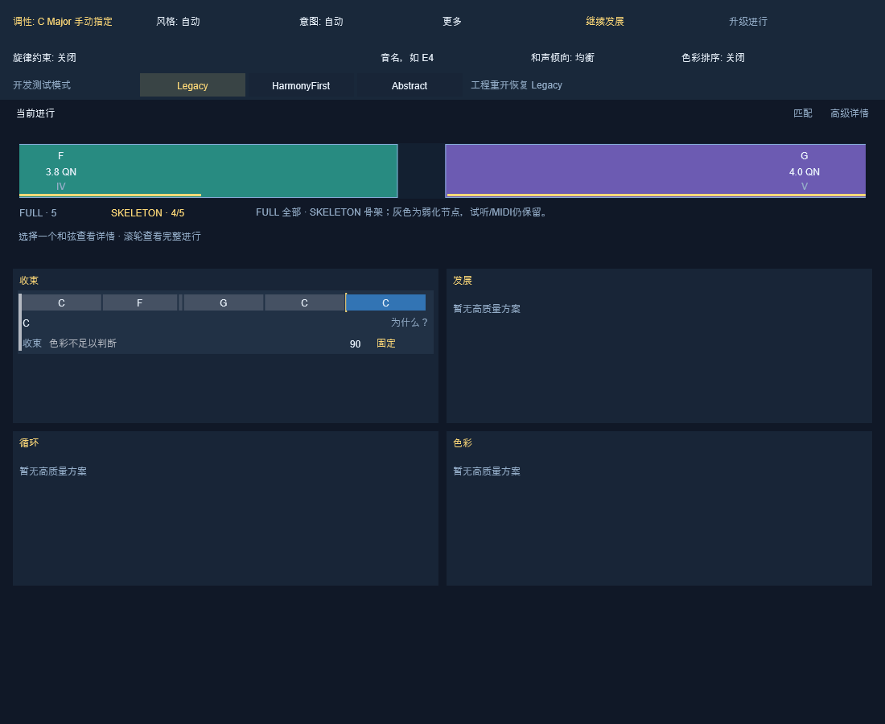

# Phase 6 单插件算法切换与音乐质量验收

本轮完成可安装的 `0.10.0-dev.7` 单插件测试版，在同一实例、同一输入中切换 Legacy、HarmonyFirst、Abstract。工程门禁通过，正式发布未授权；真实 Cubase 验收和音乐采用判断由用户执行。操作入口见 [中文验收清单](PHASE6_CUBASE_ACCEPTANCE.md)。

## 构建身份与数据边界

- 开发分支：`development/phase5-20261013`；生产 BuildCommit：`8c27c27a0c50da7fb0cf991f60ecde66890116f0`。后续文档提交不改变该二进制身份。
- 起点：Phase 5.1 `4670f24e531897e77d79d8f35ef420c23d5e13d6`；旧 dev.6 BuildCommit `3a582e4d8ea9bca5df4507a3b7abfabb08d2ecd9`。原三个模式构建及交付保留。
- Factory V4 / 657 / Schema 2：SHA-256 `74c529828f8c4b934bbaf4ada719aa95491ab498b58885522124ff6505671534`。V5/658 只作隔离只读评估；不安装、不采纳。
- User Schema 2、Session 5、Continuation Snapshot 3、Enrichment Snapshot 2 保持。`src/core`、library、session、midi、preview、snapshot、enrichment 和 data 相对 Phase 5.1 无改动。
- 验证目录：同级 `HarmonyContinuation-phase6-validation-20261014`；唯一交付目录：同级 `HarmonyContinuation-phase6-delivery-20261014`。最终二进制、安装器及交付包哈希以包内证明为准。
- VST3 二进制 SHA-256：`adc9e1c2339682fddc8b03b29fa949e3718fb1ec1678338f70379062ebfdc690`；Setup SHA-256：`eb0b9c77c8cdd42f7e679b4de68cd58c57a677e3a6d5ce0e0eda8421202409a0`。ZIP 的整包哈希在外部 `HANDOFF_PHASE6_SHA256SUMS.txt`，避免自包含校验循环。

## 实现与配置

| 运行时预设 | HarmonyFirst | Abstract | Phase 3A |
|---|---|---|---|
| Legacy（新实例及工程重开默认） | OFF | OFF | OFF |
| HarmonyFirst | ON | OFF | OFF |
| Abstract | OFF | ON | OFF |

顶部新增一行“开发测试模式”单选按钮。切换自动重新计算，不重装、不重启、不重新导入；保留输入、调性、Intent 与偏好。实验选择仅属于当前 Controller 实例，不写入工程 Schema；同一实例关闭再打开编辑器仍保留选择，恢复工程状态时明确回到 Legacy。界面同步提示这一行为。

[HarmonyFirst 选中状态](images/phase6/algorithm-HarmonyFirst.png) / [Abstract 选中状态](images/phase6/algorithm-Abstract.png)。图中为界面合约测试的固定演示卡，图片证明按钮渲染与选择状态，不以这些演示卡证明算法推荐效果。

Worker 接收显式预设，并随结果携带预设及 generation。Controller 只接收当前 generation 和当前预设的结果。切换停止 Preview，取消旧任务，清空旧匹配、卡片、升级结果及已选 MIDI；导出、试听及收藏还校验当前候选身份、分数和指纹。Legacy↔Abstract 可重用相同调性分析，推荐必重算；HF 改变有效分析上下文，缓存不能跨模式误用。Enrichment 有独立 readiness，Factory 失败不会错误屏蔽现有升级降级路径。

Factory 版本及 SHA-256 来自实际选择的 Factory 文件，哈希在 worker 加载/重新加载索引时计算，音频线程不做数据库、文件或 GUI 操作。未完成计算时诊断明确 PENDING，不把请求配置说成已执行配置。空输入也可取得 Factory 身份。诊断包含 Build ID、预设、请求与实际开关、输入/调性、匹配及推荐。

未开放 HF+Abstract、Phase 3A、ContinuousStructure 或 Phase 6 Candidate。三个模式互斥，不把旧 32 组 core 实验等同于联合插件模式已验收。

## 旧行为一致性与方法边界

固定基准 35 例，其中 25 例复用旧 Phase 4B 完全相同输入，覆盖 R01/R02/B08/B11、扩展音、转位、借用、变拍/变时值与移调；另有非完全前缀、插入/遗漏/替代、负例及各 Intent 探针。每例跑三个实际 worker 预设。

历史 Phase 4B 原始测试使用默认 `RecommendationWeights`，每组保留 3 条；旧生产 worker 保留 10 条。两种范围不能混为一谈。首次运行错误地以 cap-10 worker 对 cap-3 历史表，产生 965 行 DIFF；其中 877 是后缀 QN 文本格式，88 是保留容量导致的 disposition/rank 差异，部分也影响默认呈现。这是对照方法错误，已保留失败输出，未据此调整算法。

最终历史对照保留全部 25,929 行，以同输入、同调性/拍号、原默认 cap-3 的 direct-core control 比较 ID、key、相似度、分数、淘汰原因、排名、组内保留及完整续写。后缀按有序和弦标签及数值 QN 比较（时值容差 1e-6），避免将单位/小数位变化误判音乐差异；分数容差 1e-4、相似度 1e-6。历史 Abstract 构建中的 Phase 4B 测试本身没有打开 Abstract，只能作 Legacy 构建一致性证据；真正 Abstract ON 参照使用 Phase 5.1 Q1/Q2 production-worker cap-10 表及旧 MIDI。

最终 25 例输入及 25,929 行对照零差异；另核对 25,929 行 matcher trace、FULL/SKELETON/rhythm 子分全部一致。Phase 5.1 Q1/Q2 全部 96 条 cap-10 候选的 ID、support、相似度、分数、排名、默认卡及续写一致，旧 8 份 MIDI 逐字节相同，并与同一 Preview voicing 核对。原表 `visible` 实为 retained，最终新增独立 `newDefaultPresented` 列，没有拿历史保留标记冒充 UI 默认卡证据。

音乐基准在 `f50fec4` 执行；最终 `8c27c27` 只增加小窗口 150% 缩放时的详情浮层高度修复及已有布局测试扩展，worker/core/MIDI/Preview 未变，故复用基准。最终构建另执行完整适用回归。完整 Top10/trace/子分对照与范围见交付 `benchmark/RESULTS_ANALYSIS.md`；有限样例不代表所有可能输入的穷举证明。

## 音乐基准、评分与偏好

35 例固定语料覆盖 Pop、大小调、经过/遗漏/替代、转位、扩展、借用、调性歧义、时值和拍号；包括 3/4、4/4、5/4、6/8、7/8、9/8，2–5QN、BPM 与移调变体。`cases.tsv` 固定输入，`matches.tsv` 保存全匹配及淘汰，`top3.tsv`/`traces.txt` 保存真实 worker 排名与默认/更多，full/suffix MIDI 保留解码音高与时值核验。

只读评分审查确认 0.55 结构边界、绝对 QN/强拍加权、FULL/SKELETON 相关证据、插入的对齐及额外扣分、diversity 二次门槛等现有机制。有限消融分别移除 intent completion tie-break、unexplained insertion penalty、diversity penalty，保持 0.60/60，不合并多项放宽。分数或召回增加不能证明续写更好；没有足够音乐证据支持新评分，故不提供 Candidate。现有 ContinuousStructure 可运行，但仅作内部 core 对照，与 production worker 的默认呈现范围不同，未加菜单。

ColorPreferenceReranker 只对已有、合格、可比较的小窗口重排，不生成路线、不改变分数、不补回被匹配/资格门槛淘汰的候选。1,032 组可比较偏好配置中 75 组改变默认列表次序、21 组改变首卡，未改变 Top3 成员；Color 意图组本轮没有重排。78 组有卡的偏好导出，其首卡/Preview/primary ID 及 156 份 MIDI 一致；138 组明确无默认卡。常规导出另有 752 份 full/suffix MIDI，voicing 全通过。偏好确能改变部分次序，但受窗口与合格池限制；这不是召回提升。稀疏负例不足以证明普遍误兼容过滤。

Legacy/HF/Abstract 有默认路线的 case×Intent 槽位为 55/62/55（各 140 个槽位）。按相同输入家族比较 104 组时值/拍号等变形：HF 29 组非空并集路由一致，另 75 组双空；Legacy/Abstract 非空并集均 26 组，平均 Jaccard 0.513。HF 的有限离线稳定性更好，不能把高空组比例外推为普遍保证。连续结构 core 对照仅 21/35 例有候选，不作为用户预设或音乐优劣结论。

6 例单参数消融各 2,548 行：移除 intent completion tie-break 的分数/淘汰/rank 变化为 0/0/0，移除 diversity 为 2/2/7，移除未解释插入罚分为 14/10/16；均未采用。热索引单次样本中位数 Legacy/HF/Abstract 为 1.461/1.427/1.539ms，首个 Legacy 冷样本 129.359ms 含 Factory 加载及哈希；无重复采样，不作模式速度比较。

匿名 WAV 是内置 PreviewSynth 的规则化合成，非原作者演奏、非采样器乐器录音；固定配对输入、速度、配器和响度。新增 P1/P2 的 8 WAV/8 MIDI 在 `benchmark/run-final-verified/blind/`，答案单独放相邻 `answer-key/`。复用 Phase 5.1 Q1/Q2 原始 8 WAV/8 MIDI 在 `blind-phase51/`，答案在 `answer-key-phase51/`。共 16 WAV 均 48kHz PCM16、配对最大 RMS 差小于 0.000004dB、无削波；配对续写长度可以不同。听感自然度、解决感、节奏和是否采用由用户判断。

## R01 / R02 与人工音乐评审

R01 为 Am–G#dim–G–D/F#。V4_A08 与期待的 F–G–Am–C 不是同一路线。隔离 V5 以 2/4QN、4/4 和 7/8、OPEN、三预设作 12 格实际 worker 追踪，全部召回 Develop rank1、默认可见，后缀 F–G–Am–C。四组 Legacy full/suffix MIDI 经现有 Snapshot 回读后通过，最低音 A2–G#2–G2–F#2–F2–G2–A2–C3；其他预设只核对召回，不把四组导出说成十二组。OPEN 末音按既有延音策略展开，以实际音符时值为准。仅离线读取独立 V5 文件；不能把显式 D/F# 与无声明低音混为一谈，不能把规则化低音当原作者演奏保证。正式 Factory 仍为 V4。

R02 为 F–G–Am。实际 worker 复测 Auto/C major/A minor × 4/4/4 与 3/5/4QN × Closed/OPEN × 三预设，共 36 格、五条固定 Color ID 共 180 行。Auto 下 HF 四种条件均保留五条、默认三条；Legacy/Abstract 只有 3/5/4QN 且 OPEN 时保留五条、默认三条，其余为零；固定 C major/A minor 全为零。原 runtime 表按源码固定 ID 顺序输出，`r02-five-id-tracking.tsv` 添加显式 ID，保留原表，并引用 Phase 5.1 完整结构权重/trace（标为历史证据，不冒充本轮线程 trace）。每行有实际 key、分数、淘汰阶段、完整后缀与默认/更多。固定 ID 为 V3_SHADE_002/008/019/024/031，不以总数替代。离线结构/门槛链可定位，真实 Cubase 根因仍 UNKNOWN。

Abstract 的 Q1 C–E7–Am 与 Q2 C–Am–A7–Dm–G 保留原卡、新卡、分数、完整续写、排名和匿名 A/B。Q1 历史相关卡 rank10→5，均非默认主卡替换；Q2 有 rank3→4 和 V4_B11 进入 rank3。自动化证明身份与输出，不裁决哪条更好。

## 回归与安装保护

最终 `8c27c27` Release 完整构建通过；UILayout 定向 1/1，完整适用 CTest **34/34**，VST3 Validator **47/47**。CTest 包含运行时 UI 冒烟、worker 并发/缓存/多实例、Factory 合约、User Library、Snapshot、FULL/SKELETON、MIDI/Preview、Enrichment 和性能。User Library 关键兼容测试本轮 283 checks，Snapshot 兼容桥 75 checks 均通过；布局 157,665 checks 通过。详细输出见 `evidence/ctest/Temporary/LastTest.log`，完整命令日志和 `gate-summary.json` 保留。Validator 只作 SDK 合约检查，模拟宿主和 MainView 离屏 PNG 均不冒充 Cubase。

安装生命周期只使用新隔离 TestRoot 与独立 HKCU 注册项，不执行普通 Setup、不写真实插件目录或用户库。保留现有 BEGIN IMMEDIATE 首次初始化修复，不改数据库架构；安装升级、修复、卸载必须保留隔离用户哨兵及未管理文件。新安装器包含一个统一 VST3，用户完成一次安装后直接切模式。

最终隔离生命周期 **21 checks PASS**：缺引擎/旧引擎拒绝、仅升级插件时保留 Factory、兼容引擎添加曲库、占用拒绝、组件修复、卸载及再次安装/卸载的数据保护。测试使用短且独立 `-P6D7R2` 标识；原长测试标识的实际卸载项名称与手工夹具不一致，已仅修正测试副本标识/产物路径，断言不变。正式安装器、正式 AppId 及其 SHA 没有因此改变。首次受沙箱限制的注册表写入改由受审授权的同范围隔离执行完成；未触正式安装。

## 安装、回退与跨设备接续

关闭 Cubase，核验交付 SHA-256，运行唯一 `HarmonyContinuation-0.10.0-dev.7-Setup.exe`，扫描一次。先在工程副本中测试；切换算法不需要重复安装。About、诊断与 `BUILD_INFO.json` 应一致。

算法回退：选 Legacy，等待推荐完成。版本回退：退出宿主，保留个人库/设置备份，使用原 dev.6 或原正式安装器按既有组件方式恢复，重新扫描并核对 Build ID；不要删除 User Library、Snapshot 或未管理文件。本轮未改变 Schema，无新数据迁移；不降到不支持 User Schema 2 的旧引擎。旧包和旧构建完整保留。

源码和报告同步开发分支；单一测试交付包上传既有未发布 GitHub 草稿，保留原资产。未合并 main、未创建正式 Tag、未发布 v0.10.0。实际远端读回和资产 digest 见交付 proof。

## 工作量与限制

按工作归属分为：主代理负责局部运行时接线、风险/方法审查和集中交付；子代理负责 worker/测试、固定基准及分析、构建/门禁/隔离安装，以及文档接续。没有重复开发代理管理规范。

真实命令时长见 `command-timing.jsonl`；全阶段总工时未完整记录，不编造。曾有子代理用量限制中断，等待时间不计作工作耗时。主要成本来自 SDK/插件首次编译、测试辅助代码编译修复、cap-3/cap-10 与 retained/default 历史对照修正、完整回归和安装器生命周期。初次错误 dev.7 参数配置、两处测试辅助代码编译失败和 f50 首轮布局回归失败均保留日志；另修复 Controller 移动结果后升级推荐 readiness 的明确缺陷。修复没有修改核心评分。没有 2x/4x 容量实验、Factory V6、新抽象架构或三套重复模式包。

| 已记录的主要命令 | 对象 | 实际秒数 |
|---|---|---:|
| 完整 Release 构建 | 最终 8c27c27 | 136.413 |
| 完整 34 项串行 CTest | 最终 8c27c27 | 237.884 |
| VST3 Validator | 最终 8c27c27 | 0.604 |
| 普通 Setup 编译 | 最终 8c27c27，pwsh7 | 7.859 |
| 隔离安装生命周期 | 最终 8c27c27，21 checks | 27.171 |
| 35 例音乐基准及专项 | f50fec4，最终复用范围已说明 | 7.676 |

这些是进程命令耗时，不含阅读、判断、等待和未计时步骤；不能相加后宣称为全部工程工时。安装测试另有 PowerShell 5 编码、调用路径、沙箱注册表权限与隔离长标识注册项不一致等夹具/执行问题，原日志保留，未据此更改正式安装器或放宽断言。

未解决：真实 Cubase 行为、R02 宿主根因、Q1/Q2 及新增路线的主观采用判断；绝对 QN/变拍输入语义、稀疏负例和偏好小窗口限制记录待办，不自动扩展工程。实验预设不持久化是明示兼容选择。

## 交付索引

| 要求 | 对应交付 |
|---|---|
| 1 工程报告 | 本文 |
| 2 单一安装器 | 顶层 dev.7 Setup |
| 3 界面与操作 | 三张 MainView PNG、中文验收清单 |
| 4 旧版一致性 | oracle-comparison、parity-phase51-top10、parity-matcher-traces、phase51-midi-oracle |
| 5 运行时/并发/缓存 | ProductizationTests、RuntimeAlgorithmSwitchUI、完整 CTest 日志 |
| 6 固定语料 | cases.tsv、测试源码 phase6 模式 |
| 7 Top3/召回/稳定性 | top3.tsv、matches.tsv、traces.txt、RESULTS_ANALYSIS、metrics.json |
| 8 评分消融 | ablation.tsv、scoring-review.md；无采用改分 |
| 9 偏好效果 | color-ranking.tsv、color-export.tsv、MIDI |
| 10 R01/R02 | r01-v5-isolated.tsv、R01 MIDI、r02-five-id-tracking、历史结构/trace |
| 11 自动化 | CTest、Validator、构建日志及 gate-summary |
| 12 数据保护 | Factory 哈希、User Library/Snapshot CTest、隔离安装 proof |
| 13 身份/回退 | BUILD_INFO、SHA 清单、Git proof、本文回退步骤 |
| 14 匿名试听 | P1/P2 与复用 Q1/Q2 WAV/MIDI；答案分离 |
| 15 用户验收 | PHASE6_CUBASE_ACCEPTANCE.md 的 A–K 与记录模板 |

## 最终门禁

| 门禁 | 结果 |
|---|---|
| SINGLE PLUGIN ALGORITHM SWITCH | YES |
| SWITCH WITHOUT REINSTALL | YES |
| LEGACY BASELINE PRESERVED | YES |
| HF / ABSTRACT RUNTIME VERIFIED | YES |
| PHASE6 CANDIDATE AVAILABLE | NO |
| MUSIC BENCHMARK READY | YES |
| FACTORY V4 CHANGED | NO |
| USER LIBRARY PROTECTED | YES |
| READY FOR REAL CUBASE TEST | YES |
| REAL CUBASE TEST COMPLETED | NO |
| READY FOR FORMAL RELEASE | NO |

YES 对应本文说明的离线及隔离工程证据；真实 Cubase 和人工音乐评审仍未完成。Candidate NO 是没有足够收益证据而不开放选项的结果。
